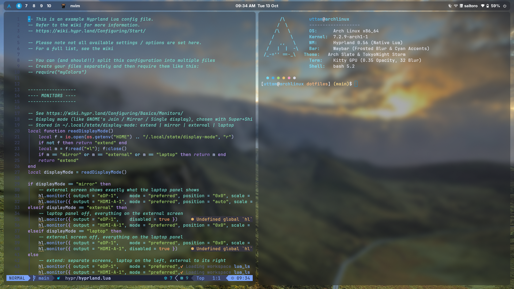
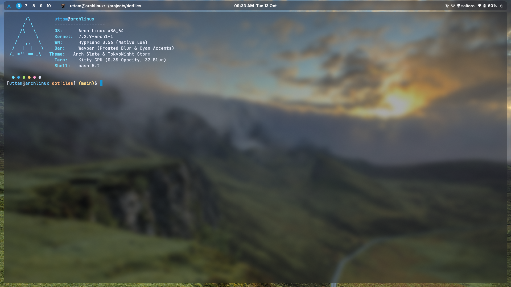
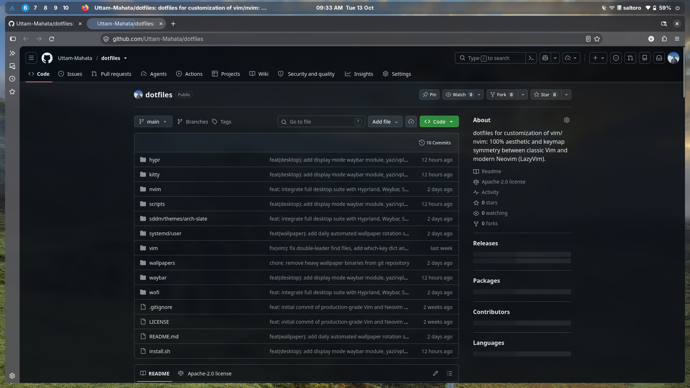
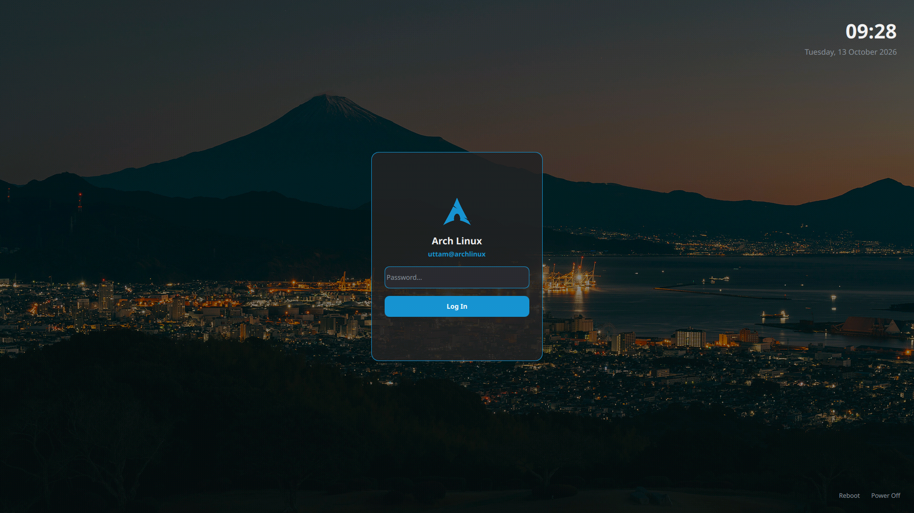

# ❄️ Arch Linux • Hyprland • Waybar • SDDM • Neovim Dotfiles

[](https://archlinux.org/)
[-00c0ff?logo=wayland&logoColor=white)](https://hyprland.org/)
[](https://github.com/Alexays/Waybar)
[](https://github.com/sddm/sddm)
[-57A143.svg?logo=neovim)](https://neovim.io/)
[](https://sw.kovidgoyal.net/kitty/)
[](LICENSE)

A complete, production-grade personal dotfiles ecosystem configured from scratch around the **Arch Linux aesthetic palette** (`#1793d1` / `#222222`) and **TokyoNight Storm**. Engineered for seamless multi-monitor development, frosted glass blur consistency, and ultra-fast keyboard-driven productivity.

---

## 📸 Screenshots Showcase

<div align="center">

### 🖥️ Desktop & Tiled Workflow
*Hyprland dynamic tiling with transparent Neovim and blurred Kitty GPU terminal over nature landscape*


<br/><br/>

| 📟 Kitty Terminal & Waybar | 🌐 Firefox & Desktop Experience |
|:---:|:---:|
|  |  |
| *Kitty GPU terminal (0.55 opacity, blur, Arch cyan cursor)* | *Firefox browsing with rounded corners & translucent Waybar* |

<br/>

### 🔐 SDDM Arch Slate Login Screen
*QtQuick 6 greeter featuring Fuji night backdrop, live date/time, and Arch Linux styling*


</div>

---

## 🎨 Unified Blur & Aesthetic Architecture

Every desktop component is calibrated for visual coherence and legibility:

| Component | Visual Styling & Blur Implementation |
|---|---|
| **Hyprland** | Modular native Lua (`hyprland.lua` + `modules/`), rounded corners (10px), 2px Arch-blue gradient focus border, dimmed inactive windows, shadows on floating windows only, smart gaps, window swallowing, and compositor blur. |
| **Waybar** | Top bar with flat high-contrast typography (Adwaita & Noto Sans), Arch blue `#1793d1` active indicators, and blurred wallpaper backdrop (`waybar-blur` layer rule). |
| **Hyprlock** | Frosted glass lockscreen with 3 blur passes, 7 blur size, live clock & date, `$USER@archlinux` banner, and Arch gradient input box. |
| **SDDM Login** | Custom **Arch Slate** QtQuick 6 greeter with matching Fuji night backdrop, live clock/date, Arch logo, and smooth authentication feedback. |
| **Kitty Terminal** | GPU-accelerated terminal with `background_opacity 0.55` and `background_blur 32`, TokyoNight palette, and split navigation. |
| **Dunst** | Rounded translucent TokyoNight notifications with Arch-blue frame, blurred backdrop, and progress-bar OSD for volume / brightness keys. |
| **Wofi** | Translucent rounded Spotlight launcher (`#outer-box` `rgba(26,27,38,0.62)`) with subtle Arch blue border and compositor layer blur (`popin 92%`). |
| **Neovim** | LazyVim with transparent TokyoNight background integration (`<leader>uT` live toggle) and blended popups (`winblend = 10`, `pumblend = 10`). |

---

## 📂 Repository Structure

```
~/projects/dotfiles/
├── assets/
│   └── screenshots/            # Showcase screenshots (SDDM, Kitty, Firefox, Workflow)
├── install.sh                  # Comprehensive modular installer (symlinks & backups)
├── hypr/
│   ├── hyprland.lua            # Entry point: loads modules/*.lua
│   ├── modules/                # monitors, looks, input, autostart, rules, binds
│   ├── hyprsunset.conf         # Night light schedule (optional hyprsunset)
│   ├── hyprlock.conf           # Arch Linux themed frosted lockscreen
│   ├── hypridle.conf           # Idle daemon (dim -> lock -> dpms off -> suspend on battery)
│   ├── hyprpaper.conf          # Wallpaper daemon configuration
│   └── scripts/
│       └── monitor-sync.sh     # Hotplug monitor & workspace rebalancing
├── waybar/
│   ├── config.jsonc            # Bar layout, modules, and persistent workspaces
│   ├── style.css               # Clean typography and Arch blue accents
│   └── scripts/
│       ├── power-menu.sh       # Interactive Wofi power & logout confirmation menu
│       ├── tailscale-exit.sh   # Tailscale exit node picker & toggle
│       └── wg.sh               # WireGuard VPN quick toggle & status
├── wofi/
│   ├── config                  # Spotlight search configuration
│   └── style.css               # Frosted translucent theme
├── kitty/
│   └── kitty.conf              # 35% opacity + blur, font ligatures, splits & tabs
├── sddm/
│   └── themes/arch-slate/      # Custom QtQuick SDDM theme
│       ├── Main.qml
│       ├── theme.conf
│       ├── metadata.desktop
│       ├── archlinux-logo.png
│       └── background.jpg
├── scripts/
│   ├── display-mode            # Switch between extend / mirror / external / laptop
│   ├── new-workspace           # Smart empty workspace creator on focused screen
│   ├── install-sddm.sh         # System installer for SDDM theme (sudo)
│   └── test-sddm.sh            # In-window SDDM theme tester
├── wallpapers/
│   ├── fuji-night-1080p.jpg    # Primary desktop & lockscreen wallpaper
│   └── ...                     # Programming & cheatsheet wallpapers
├── nvim/                       # Production LazyVim setup with transparent toggle
└── vim/                        # Classic Vimrc + coc.nvim
```

---

## 🚀 Installation & Quickstart

Clone this repository and run the automated installer:

```bash
git clone https://github.com/Uttam-Mahata/dotfiles.git ~/projects/dotfiles
cd ~/projects/dotfiles
chmod +x install.sh
```

### Full Setup (Desktop + Neovim + Vim)
```bash
./install.sh --all
```

> **Note:** By default, `install.sh` uses **symlinks** (`--link`) so that any adjustments made inside `~/projects/dotfiles` take effect immediately. Existing configuration files are automatically backed up with timestamps (`*.bak.YYYYMMDD_HHMMSS`).

### Modular Installation
```bash
./install.sh --desktop      # All desktop tools (Hyprland, Waybar, Kitty, Wofi, Scripts, Wallpapers)
./install.sh --hypr         # Hyprland, Hyprlock, Hypridle, Hyprpaper
./install.sh --packages     # Required + optional pacman packages (sudo)
./install.sh --waybar       # Waybar configuration & helper scripts
./install.sh --dunst        # Dunst notification theme
./install.sh --kitty        # Kitty terminal configuration
./install.sh --wofi         # Wofi application launcher
./install.sh --scripts      # Helper utilities (display-mode, new-workspace) to ~/.local/bin
./install.sh --wallpapers   # Wallpapers to ~/Pictures/Wallpapers
./install.sh --nvim         # Neovim (LazyVim) suite
./install.sh --vim          # Classic Vim suite
```

### SDDM Theme Setup
Preview the Arch Slate login screen in a test window:
```bash
./scripts/test-sddm.sh
```

Apply the theme system-wide (requires sudo):
```bash
./scripts/install-sddm.sh
```

---

## ⌨️ Desktop Shortcuts Reference

### System & Launchers
| Shortcut | Action |
|---|---|
| `SUPER + Q` | Launch Kitty terminal |
| `SUPER + R` | Application launcher (Wofi drun) |
| `SUPER + E` | Open Yazi file manager |
| `SUPER + /` | **Searchable keybind cheatsheet** |
| `SUPER + X` | Power menu |
| `SUPER + B` / `SUPER + SHIFT + B` | Toggle / restart Waybar |
| `SUPER + Escape` | Lock session immediately (`hyprlock`) |
| `SUPER + M` | Exit Hyprland |
| `SUPER + SHIFT + V` | Clipboard history search (`cliphist` + Wofi) |
| `SUPER + SHIFT + C` | Color picker (`hyprpicker --autocopy`) |
| `SUPER + SHIFT + W` | **Next Wallpaper** (Rotate wallpaper immediately) |
| `SUPER + SHIFT + N` / `CTRL + N` / `ALT + N` | Previous notification / dismiss all / do not disturb |

### Window & Layout Management
| Shortcut | Action |
|---|---|
| `SUPER + C` | Close focused window |
| `SUPER + V` | Toggle floating state |
| `SUPER + P` | Toggle pseudo-tile |
| `SUPER + J` | Toggle dwindle split orientation |
| `SUPER + F` / `SUPER + SHIFT + F` | Fullscreen / maximize |
| `SUPER + SHIFT + T` | Pin floating window to all workspaces |
| `SUPER + Left/Right/Up/Down` | Move focus in direction |
| `SUPER + SHIFT + Arrows` | Move window in direction |
| `SUPER + CTRL + Arrows` | Resize window (hold to repeat) |
| `SUPER + LMB (drag)` | Move window |
| `SUPER + RMB (drag)` | Resize window |

### Multi-Monitor & Displays
| Shortcut | Action |
|---|---|
| `SUPER + SHIFT + P` | **Display mode picker** (Extend / Mirror / External Only / Laptop Only) |
| `SUPER + ,` / `SUPER + .` | Focus previous / next monitor |
| `SUPER + SHIFT + ,` / `.` | Move active window to other monitor |
| `SUPER + ALT + ,` / `.` | Move active workspace to other monitor |
| `SUPER + N` | Open **new empty workspace** on focused monitor |
| `SUPER + 1..5` | Workspaces 1–5 (Laptop panel `eDP-1`) |
| `SUPER + 6..0` | Workspaces 6–10 (External monitor `HDMI-A-1`) |
| `SUPER + S` | Toggle special scratchpad workspace |
| `` SUPER + ` `` | Drop-down terminal |

### Screenshots (grim + slurp)
| Shortcut | Action |
|---|---|
| `Print` | Interactive area selection -> Save to `~/Pictures/Screenshots` & copy |
| `SUPER + Print` | Full screen capture -> Save & copy |
| `SHIFT + Print` | Active window capture -> Save & copy |
| `CTRL + Print` | Interactive area selection -> Copy to clipboard only |
| `ALT + Print` | Area selection -> annotate in `satty` (optional) |
| `SUPER + SHIFT + R` | Start / stop screen recording (`wf-recorder`, optional) -> `~/Videos/Recordings` |

---

## 💻 Neovim Highlights & Blur Controls

- **Transparency Toggle**: Press `<leader>uT` in Normal mode to toggle TokyoNight background transparency on the fly.
- **Buffer Management**: `<leader>c` or `<leader>bd` to delete buffer, `]b` / `[b` for next / previous tab.
- **Fuzzy Finding**: `<leader>ff` for files, `<leader>fg` for live ripgrep, `<leader>fb` for buffers.
- **Git**: `<leader>gs` for Neogit, `<leader>gd` for diff view.

---

## 📄 License

Licensed under the Apache License 2.0. See [LICENSE](LICENSE) for details.
